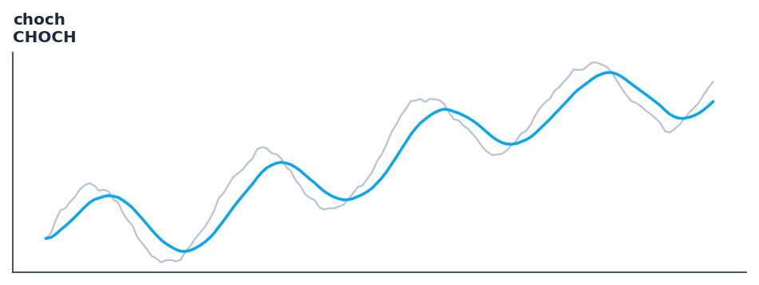

# choch

<div class="indicator-meta"><span class="category-badge">Price Action / SMC</span> <span class="kw-badge">smc</span> <span class="kw-badge">market structure</span> <span class="kw-badge">choch</span> <span class="kw-badge">bos</span> <span class="kw-badge">swings</span> <span class="kw-badge">trend</span></div>

Detects Market Structure Breaks (BOS) and Changes of Character (CHoCH) using swing highs and lows.

## Visual Example



*Synthetic ideal per library logic. Generated 2026-11-11 IST via `docs/generate_all_previews.py` (reproducible; maps to core `Next<T>` implementation).*

## Description

Detects Market Structure Breaks (BOS) and Changes of Character (CHoCH) using swing highs and lows.

Identifies trend continuations (BOS) and trend reversals (CHoCH) in market structure for Smart Money Concepts (SMC) trading strategies.

Price-action tooling with streaming and Polars batch parity. Rich outputs feed backtest signals, regime filters, and ML feature pipelines.

**Typical applications:**

- Trend filter or signal line for systematic entries
- Default lookback `5` — tune per asset volatility
- Cross with faster oscillator for entry timing
- Streaming and Polars paths are bit-identical for production parity

QuantWave implements this via the universal `Next<T>` trait — bit-identical across Rust streaming, Python streaming, and Polars `.ta()` batch plugins.

## Formula / Specification

**Implementation** (`smc`):

\[
\text{BOS} = \text{Close} > \text{SwingHigh}_{\text{bull}} \lor \text{Close} < \text{SwingLow}_{\text{bear}}, \quad \text{CHoCH} = \text{Close} < \text{SwingLow}_{\text{bull}} \lor \text{Close} > \text{SwingHigh}_{\text{bear}}
\]

Gold-standard parity vectors: `quantwave-core/tests/gold_standard/choch.json`.


## Parameters

| Parameter | Default | Description |
|-----------|---------|-------------|
| `swing_strength` | 5 | Number of bars required on each side to confirm a swing high or swing low. |


## Usage Examples

**Streaming (Rust)**

```rust
use quantwave_core::indicators::Choch;
use quantwave_core::traits::Next;

let mut ind = Choch::new(5);
for price in &prices {
    let value = ind.next(price);
}
```

**Streaming (Python)**

```python
from quantwave import Choch

ind = Choch(5)
for price in prices:
    value = ind.next(price)
```

**Polars Batch (Python)**

```python
import polars as pl
import quantwave as qw

def apply_choch(series: pl.Series) -> pl.Series:
    ind = qw.Choch(5)
    return pl.Series([ind.next(float(v)) for v in series.to_list()])

df = (
    pl.read_csv('ohlcv.csv')
    .lazy()
    .with_columns(
        pl.col("close").map_batches(apply_choch, return_dtype=pl.Float64).alias("choch")
    )
    .collect()
)
```

All surfaces are bit-identical via the single `Next<T>` implementation and proptests.

## Edge Cases & Limitations

- Warm-up: first `5` bars may return NaN or partial state per implementation.
- Parameter sensitivity: smaller periods increase noise; larger periods increase lag.
- Sudden gaps or bad ticks can distort rolling windows — consider pre-filtering.
- Single-series indicators ignore volume unless otherwise documented.
- Validated via proptests against gold-standard vectors where available.
- No look-ahead bias; streaming and Polars batch paths are bit-identical.

## Boundary Behavior

| Condition | Behavior |
|-----------|----------|
| Warm-up | Early bars return empty event lists or default structs (no scalar NaN). |
| period > len | Insufficient history yields no events rather than NaN scalars. |
| NaN inputs | NaN OHLC typically suppresses event detection for that bar. |
| Invalid params | Invalid swing_strength or tolerance raises ValueError. |
| Empty data | Empty input returns empty event collections. |

## Related Indicators & See Also

- [Indicator Gallery](../gallery.md)
- [Native Indicators index](index.md)
- [Batch vs Streaming guide](../../../examples/batch-streaming.md)
- [RSI](relative_strength_index_rsi.md)
- [SuperTrend](../supertrend/)

## Sources & References

**Primary Source**: https://www.tradingview.com/support/solutions/43000703076-market-structure/

**Implementation**: `quantwave-core/src/indicators/smc` (`Choch` / `_METADATA`).
**Parity**: `quantwave-core/tests/gold_standard/choch.json`

**Provenance**: Standards bulk upgrade 2026-11-11 IST — see `docs/DOCUMENTATION_STANDARDS.md`.
