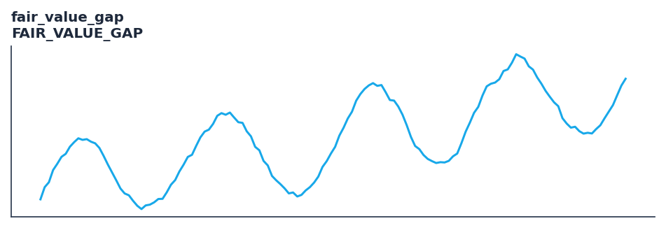

# fair_value_gap

<div class="indicator-meta"><span class="category-badge">Price Action / SMC</span> <span class="kw-badge">smc</span> <span class="kw-badge">fvg</span> <span class="kw-badge">fair value gap</span> <span class="kw-badge">imbalance</span> <span class="kw-badge">liquidity</span> <span class="kw-badge">smart money</span></div>

Detects 3-bar Fair Value Gaps (price imbalances) and tracks their mitigation and fill levels.

## Visual Example



*Synthetic ideal per library logic. Generated 2026-11-11 IST via `docs/generate_all_previews.py` (reproducible; maps to core `Next<T>` implementation).*

## Description

Detects 3-bar Fair Value Gaps (price imbalances) and tracks their mitigation and fill levels.

Identifies liquidity imbalances where price moves impulsively, leaving untraded zones that act as magnets for price retests.

Price-action tooling with streaming and Polars batch parity. Rich outputs feed backtest signals, regime filters, and ML feature pipelines.

**Typical applications:**

- See Parameters — default period/length `0.0`
- Validated via proptests and gold-standard vectors where available
- Use Polars `.ta` plugins for batch; `streaming_class()` for live

QuantWave implements this via the universal `Next<T>` trait — bit-identical across Rust streaming, Python streaming, and Polars `.ta()` batch plugins.

## Formula / Specification

**Implementation** (`smc`):

\[
\text{Bullish FVG} = \text{Low}_t > \text{High}_{t-2}, \quad \text{Bearish FVG} = \text{High}_t < \text{Low}_{t-2}
\]

Gold-standard parity vectors: `quantwave-core/tests/gold_standard/fair_value_gap.json`.


## Parameters

| Parameter | Default | Description |
|-----------|---------|-------------|
| `min_gap_size` | 0.0 | Minimum price distance required between outer bars to register a valid Fair Value Gap. |
| `max_active_gaps` | 20 | Maximum number of unmitigated or partially mitigated fair value gaps retained in memory. |


## Usage Examples

**Streaming (Rust)**

```rust
use quantwave_core::indicators::FairValueGap;
use quantwave_core::traits::Next;

let mut ind = FairValueGap::new(0.0);
for price in &prices {
    let value = ind.next(price);
}
```

**Streaming (Python)**

```python
from quantwave import FairValueGap

ind = FairValueGap(0.0)
for price in prices:
    value = ind.next(price)
```

**Polars Batch (Python)**

```python
import polars as pl
import quantwave as qw

def apply_fair_value_gap(series: pl.Series) -> pl.Series:
    ind = qw.FairValueGap(0.0)
    return pl.Series([ind.next(float(v)) for v in series.to_list()])

df = (
    pl.read_csv('ohlcv.csv')
    .lazy()
    .with_columns(
        pl.col("close").map_batches(apply_fair_value_gap, return_dtype=pl.Float64).alias("fair_value_gap")
    )
    .collect()
)
```

All surfaces are bit-identical via the single `Next<T>` implementation and proptests.

## Edge Cases & Limitations

- Warm-up: first `0.0` bars may return NaN or partial state per implementation.
- Parameter sensitivity: smaller periods increase noise; larger periods increase lag.
- Sudden gaps or bad ticks can distort rolling windows — consider pre-filtering.
- Single-series indicators ignore volume unless otherwise documented.
- Validated via proptests against gold-standard vectors where available.
- No look-ahead bias; streaming and Polars batch paths are bit-identical.

## Boundary Behavior

| Condition | Behavior |
|-----------|----------|
| Warm-up | Early bars return empty event lists or default structs (no scalar NaN). |
| period > len | Insufficient history yields no events rather than NaN scalars. |
| NaN inputs | NaN OHLC typically suppresses event detection for that bar. |
| Invalid params | Invalid swing_strength or tolerance raises ValueError. |
| Empty data | Empty input returns empty event collections. |

## Related Indicators & See Also

- [Indicator Gallery](../gallery.md)
- [Native Indicators index](index.md)
- [Batch vs Streaming guide](../../../examples/batch-streaming.md)
- [RSI](relative_strength_index_rsi.md)
- [SuperTrend](../supertrend/)

## Sources & References

**Primary Source**: https://www.tradingview.com/support/solutions/43000703078-fair-value-gaps/

**Implementation**: `quantwave-core/src/indicators/smc` (`FairValueGap` / `_METADATA`).
**Parity**: `quantwave-core/tests/gold_standard/fair_value_gap.json`

**Provenance**: Standards bulk upgrade 2026-11-11 IST — see `docs/DOCUMENTATION_STANDARDS.md`.
