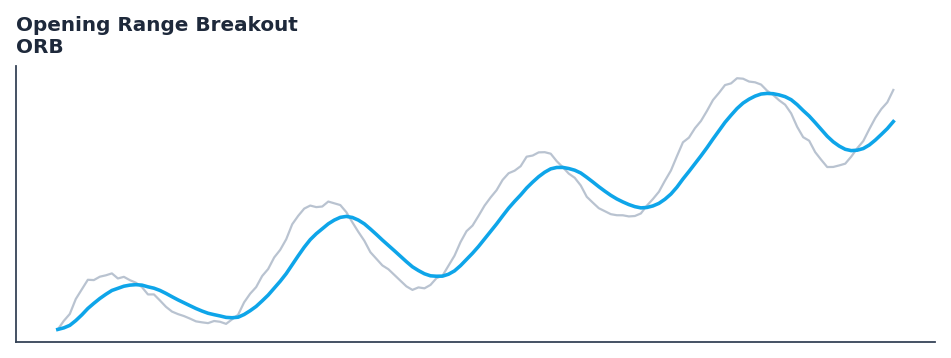

# Opening Range Breakout

<div class="indicator-meta"><span class="category-badge">Price Action</span> <span class="kw-badge">orb</span> <span class="kw-badge">opening-range</span> <span class="kw-badge">breakout</span> <span class="kw-badge">session</span> <span class="kw-badge">intraday</span> <span class="kw-badge">toby-crabel</span></div>

Tracks the high and low over the opening range bars and detects directional breakouts with extension targets.

## Visual Example



*Synthetic ideal per library logic. Generated 2026-11-11 IST via `docs/generate_all_previews.py` (reproducible; maps to core `Next<T>` implementation).*

## Description

Tracks the high and low over the opening range bars and detects directional breakouts with extension targets.

Identifies early-session market commitment and momentum expansion. When price breaks out of the established opening range, traders enter in the direction of the break targeting 0.5x and 1.0x range extensions.

Price-action tooling with streaming and Polars batch parity. Rich outputs feed backtest signals, regime filters, and ML feature pipelines.

Pioneered by Toby Crabel in 'Day Trading with Short Term Price Patterns' (1990), Opening Range Breakout establishes support and resistance during the initial minutes of trading. A decisive breakout beyond the opening boundary often signals directional conviction for the remainder of the trading day. — Toby Crabel / TradingView

**Typical applications:**

- Trend filter or signal line for systematic entries
- Default lookback `15` — tune per asset volatility
- Cross with faster oscillator for entry timing
- Streaming and Polars paths are bit-identical for production parity

QuantWave implements this via the universal `Next<T>` trait — bit-identical across Rust streaming, Python streaming, and Polars `.ta()` batch plugins.

## Formula / Specification

**Implementation** (`session_levels`):

\[
\text{Range High} = \max_{i \in [1, N]}(H_i), \quad \text{Range Low} = \min_{i \in [1, N]}(L_i) \\
\text{Range Size} = \text{Range High} - \text{Range Low} \\
\text{Target}_{1,\text{bull}} = \text{Range High} + 0.5 \cdot \text{Range Size}, \quad \text{Target}_{1,\text{bear}} = \text{Range Low} - 0.5 \cdot \text{Range Size} \\
\text{Target}_{2,\text{bull}} = \text{Range High} + 1.0 \cdot \text{Range Size}, \quad \text{Target}_{2,\text{bear}} = \text{Range Low} - 1.0 \cdot \text{Range Size}
\]

Gold-standard parity vectors: `quantwave-core/tests/gold_standard/orb.json`.


## Parameters

| Parameter | Default | Description |
|-----------|---------|-------------|
| `range_bars` | 15 | Number of opening bars defining the range window |


## Usage Examples

**Streaming (Rust)**

```rust
use quantwave_core::indicators::Orb;
use quantwave_core::traits::Next;

let mut ind = Orb::new(15);
for price in &prices {
    let value = ind.next(price);
}
```

**Streaming (Python)**

```python
from quantwave import Orb

ind = Orb(15)
for price in prices:
    value = ind.next(price)
```

**Polars Batch (Python)**

```python
import polars as pl
import quantwave as qw

def apply_opening_range_breakout(series: pl.Series) -> pl.Series:
    ind = qw.Orb(15)
    return pl.Series([ind.next(float(v)) for v in series.to_list()])

df = (
    pl.read_csv('ohlcv.csv')
    .lazy()
    .with_columns(
        pl.col("close").map_batches(apply_opening_range_breakout, return_dtype=pl.Float64).alias("opening_range_breakout")
    )
    .collect()
)
```

All surfaces are bit-identical via the single `Next<T>` implementation and proptests.

## Edge Cases & Limitations

- Warm-up: first `15` bars may return NaN or partial state per implementation.
- Parameter sensitivity: smaller periods increase noise; larger periods increase lag.
- Sudden gaps or bad ticks can distort rolling windows — consider pre-filtering.
- Single-series indicators ignore volume unless otherwise documented.
- Validated via proptests against gold-standard vectors where available.
- No look-ahead bias; streaming and Polars batch paths are bit-identical.

## Boundary Behavior

| Condition | Behavior |
|-----------|----------|
| Warm-up | Early bars return empty event lists or default structs (no scalar NaN). |
| period > len | Insufficient history yields no events rather than NaN scalars. |
| NaN inputs | NaN OHLC typically suppresses event detection for that bar. |
| Invalid params | Invalid swing_strength or tolerance raises ValueError. |
| Empty data | Empty input returns empty event collections. |

## Related Indicators & See Also

- [Indicator Gallery](../gallery.md)
- [Native Indicators index](index.md)
- [Batch vs Streaming guide](../../../examples/batch-streaming.md)
- [RSI](relative_strength_index_rsi.md)
- [SuperTrend](../supertrend/)

## Sources & References

**Primary Source**: https://www.tradingview.com/support/solutions/43000696950-opening-range-breakout-orb/

**Implementation**: `quantwave-core/src/indicators/session_levels` (`Orb` / `_METADATA`).
**Parity**: `quantwave-core/tests/gold_standard/orb.json`

**Provenance**: Standards bulk upgrade 2026-11-11 IST — see `docs/DOCUMENTATION_STANDARDS.md`.
