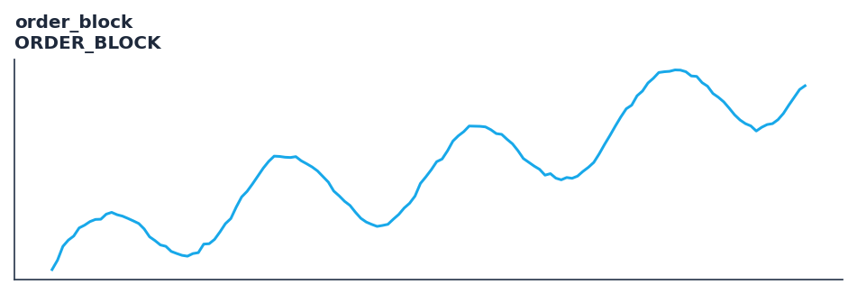

# order_block

<div class="indicator-meta"><span class="category-badge">Price Action / SMC</span> <span class="kw-badge">smc</span> <span class="kw-badge">order block</span> <span class="kw-badge">ob</span> <span class="kw-badge">smart money</span> <span class="kw-badge">mitigation</span> <span class="kw-badge">institutional</span></div>

Detects Bullish and Bearish Order Blocks (institutional entry zones) and tracks their mitigation.

## Visual Example



*Synthetic ideal per library logic. Generated 2026-11-11 IST via `docs/generate_all_previews.py` (reproducible; maps to core `Next<T>` implementation).*

## Description

Detects Bullish and Bearish Order Blocks (institutional entry zones) and tracks their mitigation.

Identifies institutional order blocks preceding energetic displacements and monitors subsequent mitigation/invalidation.

Price-action tooling with streaming and Polars batch parity. Rich outputs feed backtest signals, regime filters, and ML feature pipelines.

**Typical applications:**

- See Parameters — default period/length `20`
- Validated via proptests and gold-standard vectors where available
- Use Polars `.ta` plugins for batch; `streaming_class()` for live

QuantWave implements this via the universal `Next<T>` trait — bit-identical across Rust streaming, Python streaming, and Polars `.ta()` batch plugins.

## Formula / Specification

**Implementation** (`smc`):

\[
\text{Bullish OB} = \text{Candle}_{t-1} \text{ (down)} \land \text{Close}_t > \text{High}_{t-1}, \quad \text{Bearish OB} = \text{Candle}_{t-1} \text{ (up)} \land \text{Close}_t < \text{Low}_{t-1}
\]

Gold-standard parity vectors: `quantwave-core/tests/gold_standard/order_block.json`.


## Parameters

| Parameter | Default | Description |
|-----------|---------|-------------|
| `max_active_blocks` | 20 | Maximum number of unmitigated or partially mitigated active order blocks retained in memory. |


## Usage Examples

**Streaming (Rust)**

```rust
use quantwave_core::indicators::OrderBlock;
use quantwave_core::traits::Next;

let mut ind = OrderBlock::new(20);
for price in &prices {
    let value = ind.next(price);
}
```

**Streaming (Python)**

```python
from quantwave import OrderBlock

ind = OrderBlock(20)
for price in prices:
    value = ind.next(price)
```

**Polars Batch (Python)**

```python
import polars as pl
import quantwave as qw

def apply_order_block(series: pl.Series) -> pl.Series:
    ind = qw.OrderBlock(20)
    return pl.Series([ind.next(float(v)) for v in series.to_list()])

df = (
    pl.read_csv('ohlcv.csv')
    .lazy()
    .with_columns(
        pl.col("close").map_batches(apply_order_block, return_dtype=pl.Float64).alias("order_block")
    )
    .collect()
)
```

All surfaces are bit-identical via the single `Next<T>` implementation and proptests.

## Edge Cases & Limitations

- Warm-up: first `20` bars may return NaN or partial state per implementation.
- Parameter sensitivity: smaller periods increase noise; larger periods increase lag.
- Sudden gaps or bad ticks can distort rolling windows — consider pre-filtering.
- Single-series indicators ignore volume unless otherwise documented.
- Validated via proptests against gold-standard vectors where available.
- No look-ahead bias; streaming and Polars batch paths are bit-identical.

## Boundary Behavior

| Condition | Behavior |
|-----------|----------|
| Warm-up | Early bars return empty event lists or default structs (no scalar NaN). |
| period > len | Insufficient history yields no events rather than NaN scalars. |
| NaN inputs | NaN OHLC typically suppresses event detection for that bar. |
| Invalid params | Invalid swing_strength or tolerance raises ValueError. |
| Empty data | Empty input returns empty event collections. |

## Related Indicators & See Also

- [Indicator Gallery](../gallery.md)
- [Native Indicators index](index.md)
- [Batch vs Streaming guide](../../../examples/batch-streaming.md)
- [RSI](relative_strength_index_rsi.md)
- [SuperTrend](../supertrend/)

## Sources & References

**Primary Source**: https://www.tradingview.com/support/solutions/43000703077-order-blocks/

**Implementation**: `quantwave-core/src/indicators/smc` (`OrderBlock` / `_METADATA`).
**Parity**: `quantwave-core/tests/gold_standard/order_block.json`

**Provenance**: Standards bulk upgrade 2026-11-11 IST — see `docs/DOCUMENTATION_STANDARDS.md`.
