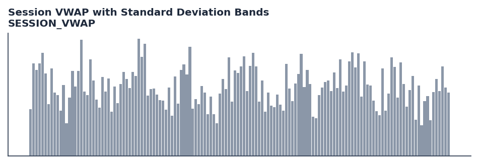

# Session VWAP with Standard Deviation Bands

<div class="indicator-meta"><span class="category-badge">Volume</span> <span class="kw-badge">vwap</span> <span class="kw-badge">session</span> <span class="kw-badge">intraday</span> <span class="kw-badge">volume</span> <span class="kw-badge">bands</span> <span class="kw-badge">standard-deviation</span></div>

Session-anchored Volume Weighted Average Price (VWAP) with three standard deviation volatility bands, resetting at session boundaries.

## Visual Example



*Synthetic ideal per library logic. Generated 2026-11-11 IST via `docs/generate_all_previews.py` (reproducible; maps to core `Next<T>` implementation).*

## Description

Session-anchored Volume Weighted Average Price (VWAP) with three standard deviation volatility bands, resetting at session boundaries.

Use as an intraday fair value benchmark. The core VWAP serves as the primary institutional execution level, while Sigma 1, 2, and 3 standard deviation bands identify statistical mean reversion boundaries and dynamic support/resistance.

Volume-flow indicator for confirming price moves and detecting accumulation/distribution.

Volume Weighted Average Price calculates the cumulative typical price weighted by volume across a trading session. Incorporating standard deviation bands provides dynamic volatility envelopes that highlight statistical value containment and institutional liquidation extremes. — StockCharts / Investopedia

**Typical applications:**

- Size stops and position risk from band width or ATR expansion
- Detect squeeze conditions (narrow bands) before breakout systems
- Warm-up: first `N` bars build rolling volatility state
- Combine with trend direction (SuperTrend, MACD) for breakout bias

QuantWave implements this via the universal `Next<T>` trait — bit-identical across Rust streaming, Python streaming, and Polars `.ta()` batch plugins.

## Formula / Specification

**Implementation** (`session_levels`):

\[
TP_t = \frac{H_t + L_t + C_t}{3} \\
VWAP_t = \frac{\sum_{i=1}^t TP_i \cdot V_i}{\sum_{i=1}^t V_i} \\
\sigma_t = \sqrt{\frac{\sum_{i=1}^t V_i \cdot (TP_i - VWAP_t)^2}{\sum_{i=1}^t V_i}} \\
\text{Upper}_k = VWAP_t + k \cdot \sigma_t, \quad \text{Lower}_k = VWAP_t - k \cdot \sigma_t \quad (k \in \{1, 2, 3\})
\]

Gold-standard parity vectors: `quantwave-core/tests/gold_standard/session_vwap.json`.


## Parameters

| Parameter | Default | Description |
|-----------|---------|-------------|
| (none) | — | No tunable parameters for this detector. |

## Usage Examples

**Streaming (Rust)**

```rust
use quantwave_core::indicators::SessionVwap;
use quantwave_core::traits::Next;

let mut ind = SessionVwap::new(14);
for price in &prices {
    let value = ind.next(price);
}
```

**Streaming (Python)**

```python
from quantwave import SessionVwap

ind = SessionVwap(14)
for price in prices:
    value = ind.next(price)
```

**Polars Batch (Python)**

```python
import polars as pl
import quantwave as qw

def apply_session_vwap_with_standard_deviation_bands(series: pl.Series) -> pl.Series:
    ind = qw.SessionVwap(14)
    return pl.Series([ind.next(float(v)) for v in series.to_list()])

df = (
    pl.read_csv('ohlcv.csv')
    .lazy()
    .with_columns(
        pl.col("close").map_batches(apply_session_vwap_with_standard_deviation_bands, return_dtype=pl.Float64).alias("session_vwap_with_standard_deviation_bands")
    )
    .collect()
)
```

All surfaces are bit-identical via the single `Next<T>` implementation and proptests.

## Edge Cases & Limitations

- Warm-up: first `N` bars may return NaN or partial state per implementation.
- Parameter sensitivity: smaller periods increase noise; larger periods increase lag.
- Sudden gaps or bad ticks can distort rolling windows — consider pre-filtering.
- Single-series indicators ignore volume unless otherwise documented.
- Validated via proptests against gold-standard vectors where available.
- No look-ahead bias; streaming and Polars batch paths are bit-identical.

## Boundary Behavior

| Condition | Behavior |
|-----------|----------|
| Warm-up | Leading bars return NaN until warmup_bars is satisfied. |
| period > len | When period exceeds series length, output is all NaN. |
| NaN inputs | NaN in input propagates to output (NaN out). |
| Invalid params | Non-positive period or missing required params raise ValueError. |
| Empty data | Empty input returns an empty result series. |

## Related Indicators & See Also

- [Indicator Gallery](../gallery.md)
- [Native Indicators index](index.md)
- [Batch vs Streaming guide](../../../examples/batch-streaming.md)
- [RSI](relative_strength_index_rsi.md)
- [SuperTrend](../supertrend/)

## Sources & References

**Primary Source**: https://chartschool.stockcharts.com/table-of-contents/technical-indicators-and-overlays/technical-overlays/vwap-standard-deviation-bands

**Implementation**: `quantwave-core/src/indicators/session_levels` (`SessionVwap` / `_METADATA`).
**Parity**: `quantwave-core/tests/gold_standard/session_vwap.json`

**Provenance**: Standards bulk upgrade 2026-11-11 IST — see `docs/DOCUMENTATION_STANDARDS.md`.
