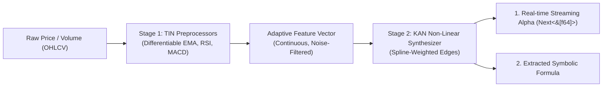

# Machine Learning & Neural Indicators

QuantWave introduces production-grade, streaming-native Machine Learning and Neural Indicator architectures directly into its high-performance Rust core.

Unlike generic "black-box" deep learning models (such as massive multi-layer perceptrons or quadratic Transformers) that struggle with low signal-to-noise ratios in financial time series, QuantWave implements **interpretable, finance-native neural paradigms**:

1. **Kolmogorov-Arnold Networks (KAN)**: Edge-parameterized non-linear function synthesis with symbolic mathematical rule extraction.
2. **Technical Indicator Networks (TIN)**: Differentiable, learnable technical indicators with exact recurrence analytical parameter gradients.

---

## 1. Kolmogorov-Arnold Networks (KAN)

### Mathematical Foundation

Based on the Kolmogorov-Arnold representation theorem and the recent **KASPER** framework (*Transactions on Machine Learning Research*, 2026 / arXiv:2507.18983), KANs replace fixed linear weights and static node activations with **learnable univariate 1D B-spline curves on network edges**:

$$f(\mathbf{x}) = \sum_{q=1}^{2n+1} \Phi_q \left( \sum_{p=1}^n \phi_{q,p}(x_p) \right)$$

Each edge activation $\phi(x)$ combines a smooth residual base activation ($\text{SiLU}$) with a linear combination of order-$k$ B-splines over a uniform knot grid:

$$\phi(x) = w_{\text{base}} \cdot \text{SiLU}(x) + \sum_{i=1}^{G+k-1} c_i B_{i,k}(x)$$

Where:
* $G$: Number of uniform grid intervals on $[x_{\min}, x_{\max}]$.
* $k$: Spline polynomial degree (typically cubic, $k = 3$).
* $B_{i,k}(x)$: Cox-de Boor recursive basis function.
* $c_i$: Trainable spline coefficients.

### Core Components

| Type | Path | Purpose |
| :--- | :--- | :--- |
| [`BSplineBasis`](file:///Users/mayanklavania/moonshot_projects/quantwave/quantwave-core/src/ml/bspline.rs) | `quantwave_core::ml::BSplineBasis` | Uniform B-spline basis evaluator using Cox-de Boor recursion. Enforces partition of unity ($\sum B_i = 1$) and boundary clamping. |
| [`KanLayer`](file:///Users/mayanklavania/moonshot_projects/quantwave/quantwave-core/src/ml/kan/layer.rs) | `quantwave_core::ml::KanLayer` | Single KAN layer mapping $n$ inputs to $m$ outputs via learnable edge splines. |
| [`KanNetwork`](file:///Users/mayanklavania/moonshot_projects/quantwave/quantwave-core/src/ml/kan/network.rs) | `quantwave_core::ml::KanNetwork` | Deep sequential composition of KAN layers with ping-pong buffering. |
| [`KanIndicator`](file:///Users/mayanklavania/moonshot_projects/quantwave/quantwave-core/src/ml/kan/network.rs) | `quantwave_core::ml::KanIndicator` | Streaming indicator implementing `Next<&[f64], Output = f64>` with zero runtime heap allocations. |
| [`extract_symbolic_formula`](file:///Users/mayanklavania/moonshot_projects/quantwave/quantwave-core/src/ml/kan/symbolic.rs) | `quantwave_core::ml::extract_symbolic_formula` | Prunes inactive edges ($L_1$ norm) and exports an interpretable mathematical formula. |

### Rust Usage: Streaming & Symbolic Rule Extraction

```rust
use quantwave_core::ml::{BSplineBasis, KanLayer, KanNetwork, KanIndicator, extract_symbolic_formula};
use quantwave_core::traits::Next;

fn main() -> Result<(), Box<dyn std::error::Error>> {
    // 1. Define uniform B-spline basis on normalized input range [-2.0, 2.0]
    let basis = BSplineBasis::new(5, 3, -2.0, 2.0)?; // 5 intervals, cubic degree

    // 2. Build a 2-layer KAN: 4 features -> 3 hidden -> 1 output signal
    let layer1 = KanLayer::new(4, 3, basis.clone())?;
    let layer2 = KanLayer::new(3, 1, basis)?;
    let network = KanNetwork::new(vec![layer1, layer2])?;

    // 3. Extract the human-readable formula learned by the model
    let feature_names = ["returns_5", "vol_ratio", "rsi_normalized", "cycle_phase"];
    let formula = extract_symbolic_formula(&network, &feature_names)?;
    println!("Learned Formula: {}", formula);
    // Output: "f(x) = 0.85 * f_1(returns_5) + 0.42 * f_2(vol_ratio)"

    // 4. Wrap into a real-time streaming indicator (zero heap allocation on hot path)
    let mut indicator = KanIndicator::new(network)?;

    let live_features = [0.12, 1.45, -0.35, 0.88];
    let signal = indicator.next(&live_features);
    println!("Current Alpha Signal: {:.4}", signal);

    Ok(())
}
```

---

## 2. Technical Indicator Networks (TIN)

### Mathematical Foundation

Based on Longfei Lu's framework (*arXiv:2507.20202*), TIN reformulates traditional rule-based heuristics into **differentiable neural layers**. Instead of discrete, fixed parameters (such as a 14-period RSI or a 20-period moving average), parameters are continuous real numbers $\tau \in \mathbb{R}^+$ that can be dynamically tuned via gradient descent.

#### Analytical Recurrence Gradient for EMA
For an Exponential Moving Average $y_t = \alpha x_t + (1 - \alpha) y_{t-1}$ with smoothing factor $\alpha = \frac{2}{\tau + 1}$, QuantWave computes the **exact recurrence derivative** without an autograd graph:

$$\frac{\partial y_t}{\partial \alpha} = (x_t - y_{t-1}) + (1 - \alpha) \frac{\partial y_{t-1}}{\partial \alpha}$$

By the chain rule with respect to span $\tau$:

$$\frac{\partial \alpha}{\partial \tau} = -\frac{2}{(\tau + 1)^2} \implies \frac{\partial y_t}{\partial \tau} = \frac{\partial y_t}{\partial \alpha} \cdot \left( -\frac{2}{(\tau + 1)^2} \right)$$

### Core Components

| Type | Path | Purpose |
| :--- | :--- | :--- |
| [`DifferentiableEma`](file:///Users/mayanklavania/moonshot_projects/quantwave/quantwave-core/src/ml/tin/smoothing.rs) | `quantwave_core::ml::DifferentiableEma` | Continuous lookback EMA with analytical gradients and `update_span` SGD method. Implements `SmoothingAlgorithm`. |
| [`DifferentiableRsi`](file:///Users/mayanklavania/moonshot_projects/quantwave/quantwave-core/src/ml/tin/rsi.rs) | `quantwave_core::ml::DifferentiableRsi` | Continuous RSI with dual-EMA gain/loss tracking and soft sigmoidal decision bounds. |
| [`DifferentiableMacd`](file:///Users/mayanklavania/moonshot_projects/quantwave/quantwave-core/src/ml/tin/macd.rs) | `quantwave_core::ml::DifferentiableMacd` | Three-smoother MACD tracking fast, slow, and signal spans with analytical derivatives. |

### Rust Usage: Streaming & Parameter Calibration

```rust
use quantwave_core::ml::{DifferentiableEma, DifferentiableRsi};
use quantwave_core::traits::Next;

fn main() -> Result<(), Box<dyn std::error::Error>> {
    // Initialize a differentiable EMA with continuous span 14.5
    let mut ema = DifferentiableEma::new(14.5)?;

    let prices = [100.0, 102.5, 101.8, 104.2, 103.9];
    let target = 105.0; // Desired target price for calibration
    let learning_rate = 0.05;

    for &price in &prices {
        let smoothed = ema.next(price);
        
        // Compute loss gradient: dL/dY = 2 * (smoothed - target)
        let loss_gradient = 2.0 * (smoothed - target);
        
        // Update span along the analytical gradient (constrained to [5.0, 50.0])
        ema.update_span(learning_rate, loss_gradient, 5.0, 50.0);
    }

    println!("Calibrated EMA span: {:.2}", ema.span());

    // Continuous RSI with soft sigmoidal signal [-1.0, 1.0]
    let mut rsi = DifferentiableRsi::new(14.0, 70.0, 30.0)?;
    let output = rsi.next(103.9);
    println!("RSI: {:.2}, Soft Signal: {:.4}, dRSI/dSpan: {:.4}", 
             output.rsi, output.signal, output.grad_span);

    Ok(())
}
```

---

## 3. The Two-Stage "TIN-KAN" Pipeline

By chaining TIN and KAN together, quants achieve an optimal balance between domain-specific filtering and non-linear alpha discovery:



1. **Stage 1 (Feature Normalization & Adaptation)**: Differentiable indicators adapt their lookback periods to current volatility regimes without lookahead bias.
2. **Stage 2 (Non-Linear Interaction)**: The KAN layer models cross-feature non-linearities and outputs an alpha signal.
3. **Symbolic Auditing**: Quants inspect the exact mathematical formula generated by the network, allowing compliance, auditing, and ultra-fast static code generation.

---

## 4. Python API (`quantwave.ml`)

QuantWave exposes the full KAN and TIN capability set to Python via `quantwave.ml`:

### KAN in Python: Interactive Alpha Discovery & Distillation

```python
import quantwave as qw
from quantwave.ml import KanNetwork, KanIndicator, extract_symbolic_formula, extract_feature_importance

# 1. Initialize a 3-layer KAN: 3 features -> 6 hidden -> 1 output
kan = KanNetwork(layers=[3, 6, 1], grid_size=5, spline_order=3)

# 2. Forward inference on single sample or batch
features = [0.25, -0.40, 0.65]  # e.g., normalized [RSI, MACD, Volume Imbalance]
alpha = kan.forward(features)
print(f"Alpha signal: {alpha[0]:.4f}")

# 3. Batch evaluation over 2D dataset
dataset = [
    [0.1, -0.2, 0.3],
    [-0.4, 0.0, 0.5],
    [0.8, -0.5, 0.2],
]
batch_signals = kan.forward_batch(dataset)

# 4. Symbolic distillation: extract interpretable closed-form mathematical rules
feature_names = ["norm_rsi", "norm_macd", "volume_imbalance"]
formula = extract_symbolic_formula(kan, feature_names)
print(f"Distilled Formula: {formula}")
# Output: "5.41 * f_1(norm_rsi) + 5.40 * f_2(norm_macd) + 5.40 * f_3(volume_imbalance)"

# 5. Ranked Feature Importance
importance = extract_feature_importance(kan, feature_names)
for item in importance:
    print(f"{item['feature_name']}: {item['relative_importance']:.1%} importance (L1: {item['l1_norm']:.2f})")

# 6. Stream live ticks with zero runtime allocations
indicator = KanIndicator(kan)
live_signal = indicator.next([0.28, -0.35, 0.58])

# 7. Model Serialization & Checkpointing
# Save trained network weights and spline coefficients to JSON
json_weights = kan.to_json()

# Reload network in production or another service
restored_kan = KanNetwork.from_json(json_weights)
assert restored_kan.forward(features) == alpha
```

### TIN in Python: Continuous Differentiable Indicators

```python
from quantwave.ml import DifferentiableEma, DifferentiableRsi, DifferentiableMacd

# Differentiable EMA with analytical gradient tracking
ema = DifferentiableEma(span=10.0)
price = 105.2
val, grad_span = ema.step(price)
print(f"EMA: {val:.2f}, dY/dSpan: {grad_span:.4f}")

# Online SGD adaptation toward target
ema.update_span(learning_rate=0.1, loss_gradient=1.0, min_span=2.0, max_span=50.0)
print(f"Updated Span: {ema.span:.2f}")

# Differentiable RSI with soft sigmoidal trade signal
rsi = DifferentiableRsi(span=14.0, overbought=70.0, oversold=30.0, steepness=0.1)
rsi_val, soft_signal, rsi_grad = rsi.step(108.5)
print(f"RSI: {rsi_val:.1f}, Signal [-1, 1]: {soft_signal:.3f}")

# Differentiable MACD
macd = DifferentiableMacd(fast_span=12.0, slow_span=26.0, signal_span=9.0)
line, signal_line, hist, g_fast, g_slow, g_sig = macd.step(108.5)
print(f"MACD Line: {line:.2f}, Histogram: {hist:.2f}")
```

### End-to-End PyTorch Autograd Integration

QuantWave provides native `torch.autograd.Function` and `nn.Module` wrappers (`LearnableEma`, `LearnableRsi`) enabling indicators to be dropped directly into PyTorch neural training pipelines:

```python
import torch
from quantwave.ml import LearnableEma, LearnableRsi

# Historical price tensor with gradient tracking
prices = torch.tensor([100.0, 102.5, 101.8, 104.2, 103.9, 106.1], requires_grad=True)
target = torch.tensor([100.0, 101.0, 101.5, 103.0, 104.0, 105.0])

# Learnable EMA layer: initial span 14.0 (trainable nn.Parameter)
model = LearnableEma(initial_span=14.0, min_span=2.0, max_span=50.0)
optimizer = torch.optim.Adam(model.parameters(), lr=0.2)

# Training loop: PyTorch backpropagates through QuantWave's Rust analytical recurrence gradients
for epoch in range(10):
    optimizer.zero_grad()
    smoothed = model(prices)
    loss = (smoothed - target).pow(2).mean()
    loss.backward()
    optimizer.step()
    print(f"Epoch {epoch}: Loss = {loss.item():.4f}, Span = {model.span.item():.2f}")

# Trainable RSI with dynamic volatility adaptation
rsi_model = LearnableRsi(initial_span=14.0, overbought=70.0, oversold=30.0)
rsi_vals, soft_signals = rsi_model(prices)
```

